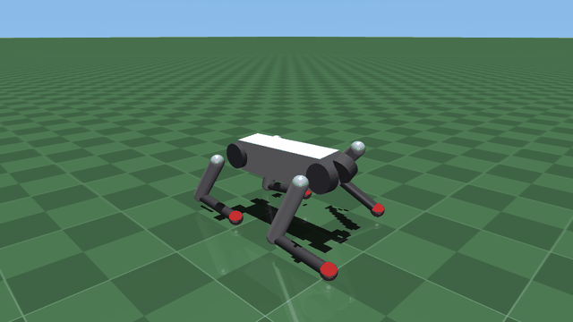
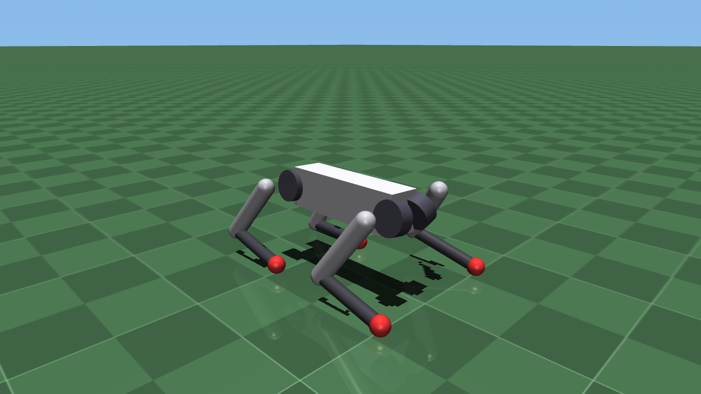
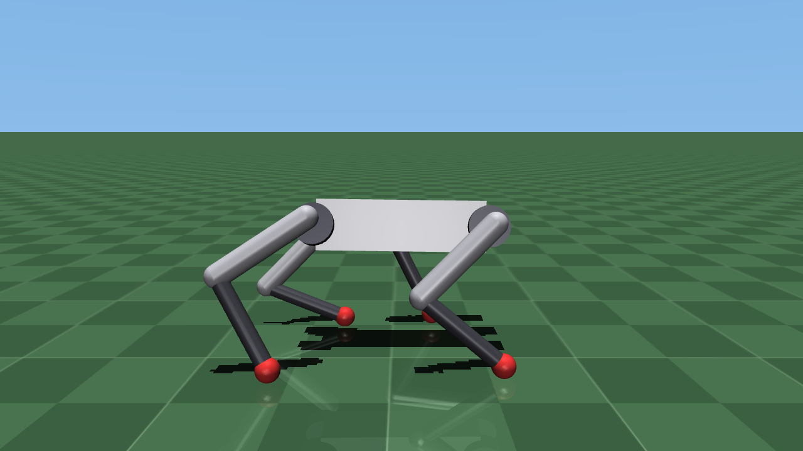
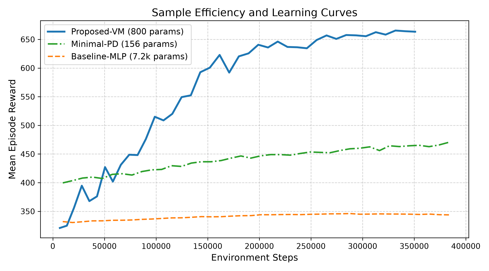
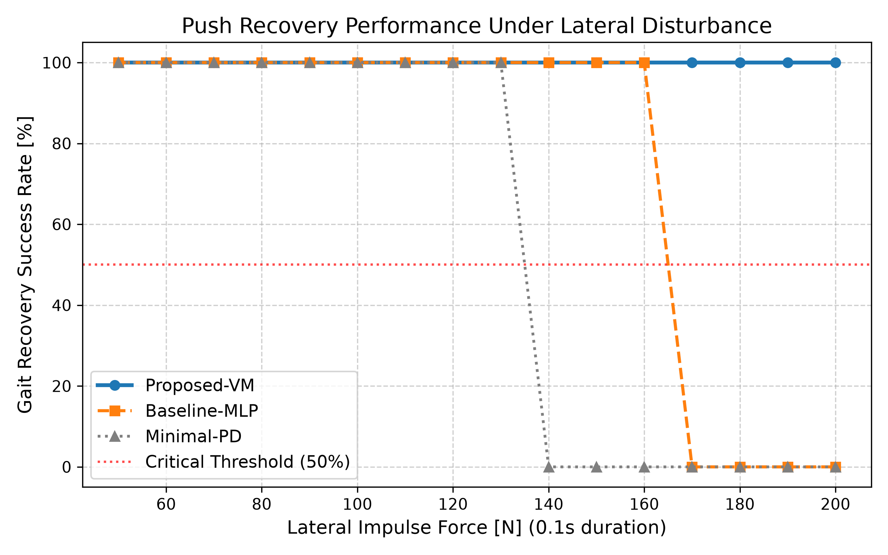
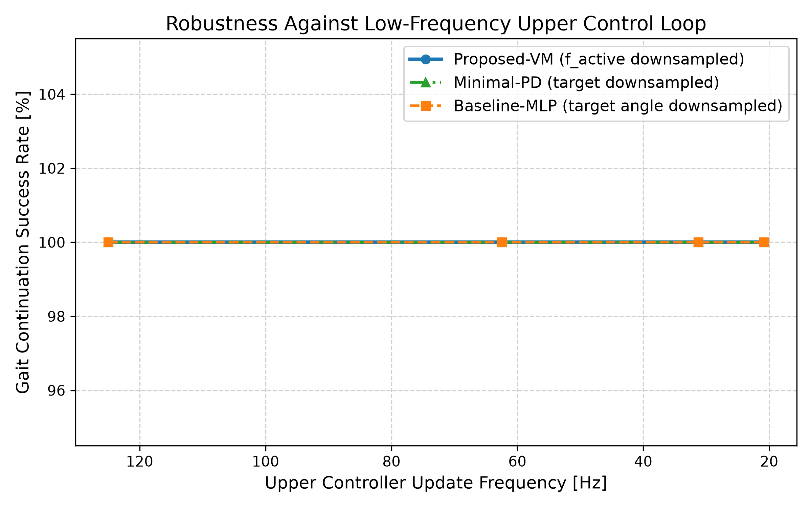
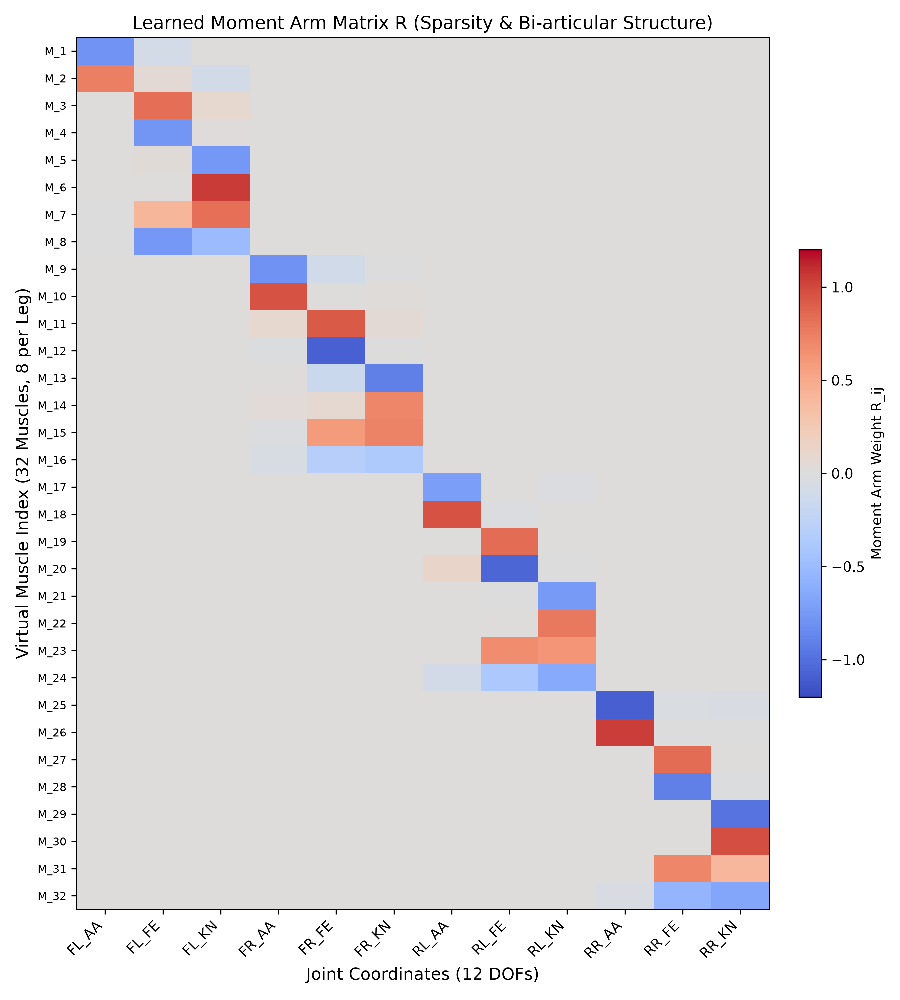

# 身体化パーセプトロン表現に基づく仮想多関節筋骨格レイヤーと極小神経回路の共設計による四脚歩行制御

**Co-design of Virtual Biarticular Musculoskeletal Layer and Minimal Neural Circuit Based on Embodied Perceptron for Quadruped Locomotion**

西住 (Nishizumi) / Nishizumi Lab  
公開日: 2026年10月  
DOI: [10.5281/zenodo.23533255](https://doi.org/10.5281/zenodo.23533255)  
リポジトリ: [https://github.com/nishizumi-lab/paper-embodied-perceptron-quadruped](https://github.com/nishizumi-lab/paper-embodied-perceptron-quadruped)

---

## 概要（Abstract）

深層強化学習を用いた四脚歩行ロボットの制御では、上位のニューラルネットワークが目標関節角度を出力し、下位の関節独立型PD制御器がトルクを生成する構成が広く採用されている。しかし、各関節が独立した単関節バネとして振る舞うため、多関節間の協調運動や衝撃吸収の計算をすべて上位の巨大なネットワークに依存しており、サンプル効率の低下やブラックボックス化による解釈性の欠如が課題となっている。

本研究では、腱駆動機構の静力学モデルと3層パーセプトロンの数理的等価性に着目した身体化パーセプトロン表現を、電動四脚ロボットの仮想インピーダンス制御則として実装する手法を提案する。提案手法では、多関節をまたぐ仮想モーメントアーム行列と腱のたるみ特性（ReLU関数）から成る微分可能な仮想筋骨格レイヤーを構築し、その結合重みと上位の極小リズム生成回路を進化強化学習により同時に最適化する。

物理シミュレータMuJoCo上の12自由度四脚ロボット（Unitree Go2モデル）を用いた検証の結果、提案手法は従来の多層パーセプトロンおよび独立PD制御と比較して、約28分の1のパラメータ数（800パラメータ）で安定したトロット歩行（前進速度 0.61 m/s）を迅速に獲得した。さらに、未知の横方向撃力外乱に対して1.25倍から1.54倍の耐性を示し、上位制御ループの更新周波数を20.8 Hzまで低減しても安定して歩行を継続した。また、学習された仮想モーメントアーム行列の解析により、生物の二関節筋（大腿直筋・ハムストリングス）に相当する拮抗・協調配線が自律的に創発されることを確認した。

  

---

## 1. 序論（Introduction）

電動モーターで駆動される四脚歩行ロボット（Unitree Go2やANYmal等）の運動制御において、深層強化学習（Deep Reinforcement Learning: DRL）は不整地走破や高速移動に高い性能を示している。現在のDRLにおける事実上の標準的なアプローチは、方策ネットワークが各関節の目標角度を出力し、モータードライバ内部のPD制御（比例・微分制御）によって関節トルクへ変換する階層構造をとっている。

しかし、この独立PD制御は各関節を個別の仮想単関節バネとして扱うため、股関節と膝関節の連動といった多関節間の力学的協調（生体における二関節筋の作用）を直接表現することができない。結果として、上位の方策ネットワークは環境との複雑な力学相互作用をすべてソフトウェア上の高次元な非線形関数として学習する必要があり、数万から数十万個のパラメータと膨大な学習試行回数を要する。また、物理的な受動性を保証しないブラックボックスな方策は、学習環境外の段差や衝突に直面した際に非現実的な高トルク指令を出力し、実機の転倒や破損を招く危険性がある。

一方、生物の運動系や腱駆動ロボットにおいては、複数の関節をまたぐ筋肉・腱の配線構造とバネの弾性、およびワイヤーのたるみ（Slack）が物理的な情報処理機構として機能し、脳の計算負荷を大幅に軽減している。増田・Taoらは、この筋骨格系の静力学モデルが重み共有構造とReLU活性化関数を持つ3層パーセプトロンと数学的に等価であることを示し、身体構造と神経系を同一の計算グラフ上で最適化する「身体化パーセプトロン表現（Embodied Perceptron Representation）」を提唱した。しかし、この表現を実際のワイヤーやプーリとして物理実装する場合、ワイヤーのクリープ変形や摩擦、設計変更の困難さといった機械的制約が伴う。

そこで本研究では、身体化パーセプトロン表現を物理的なワイヤーではなく、電動モーターのソフトウェア制御則（仮想インピーダンス制御）として実装する「仮想筋骨格レイヤー」を提案する。これにより、既存の直結駆動型電動四脚ロボットのハードウェアを一切改造することなく、機械的摩耗のない理想的な多関節腱ネットワークの力学特性をモーター制御系に付与できる。本研究の貢献は以下の3点に集約される。

1. 身体化パーセプトロン表現を電動四脚ロボットの仮想インピーダンス制御として定式化し、多関節間の結合行列と初期張力バイアスを方策の一部としてEnd-to-Endで学習可能なアーキテクチャを構築した点。
2. 従来の独立PD制御を用いた深層強化学習と比較し、極小のパラメータ数（800パラメータ）で高いサンプル効率と外乱耐性を達成できることをシミュレーション実験により定量的に実証した点。
3. 学習によって獲得された仮想モーメントアーム行列を可視化・解析し、タスク要求のみから生体の二関節筋に類似した機能的配線が自律的に獲得されることを示した点。

---

## 2. 関連研究（Related Work）

本研究の位置づけを明確にするため、制御工学、生体模倣ロボティクス、および強化学習における既存手法との比較を表1に示す。

表1: 歩行制御手法の比較と本研究の位置づけ

| 手法分類 | 代表的研究 | 多関節協調の表現 | 腱のたるみ（非線形性） | 構造パラメータの獲得手法 |
| --- | --- | --- | --- | --- |
| 仮想モデル制御（VMC） | Pratt et al. (1997) | ヤコビ行列による座標変換 | 考慮しない（線形バネ） | 人間による手動設計・固定 |
| 神経筋骨格反射制御 | Geyer et al. (2003) | 解剖学に基づく多関節筋モデル | Hill型筋モデルによる精密計算 | 生体知見に基づく手動調整 |
| 関節空間PD制御＋DRL | Peng et al. (2017) | なし（単位行列に固定） | なし（線形PD制御） | 上位NNのみ強化学習 |
| 身体化パーセプトロン（物理実装） | Masuda & Tao et al. (2025) | モーメントアーム行列 $R$ | ReLU関数によるたるみ表現 | 勾配法・進化計算による共設計 |
| 仮想筋骨格レイヤー（提案手法） | 本研究 | 仮想モーメントアーム行列 $R$ | ReLU関数＋仮想減衰項 | 強化学習による制御器との共設計 |

仮想モデル制御（VMC）は、仮想的なバネ・ダンパをヤコビ行列で関節トルクへ変換する手法であるが、バネの配置は設計者が直感的に定義する必要があった。また、Geyerらの神経筋骨格モデルは生体のHill型筋モデルをソフトウェアで忠実に再現するものの、微分方程式が複雑であり、深層学習のレイヤーとして簡潔に微分・最適化することが困難であった。本研究は、VMCの実装容易性と身体化パーセプトロンの学習可能性を統合し、現代の強化学習におけるアクチュエータ層を再定義するものである。

---

## 3. 提案手法（Proposed Method）

### 3.1 仮想筋骨格レイヤーの数理モデル

$n$ 個の関節（四脚ロボットでは $n = 12$）と、仮想的に配置された $m$ 本の多関節筋（腱・バネ要素、$m > n$）を考える。現在の関節角度ベクトルを $\theta \in \mathbb{R}^n$、関節角速度ベクトルを $\dot{\theta} \in \mathbb{R}^n$ とするとき、仮想筋骨格レイヤーが出力する関節トルク $\tau \in \mathbb{R}^n$ を以下の式で定義する。

$$\tau = -R^\top \phi\left(K(R\theta + b) + D R\dot{\theta}\right) + R^\top f_{\text{active}}(t)$$

ここで、各変数の定義とニューラルネットワークとしての対応は以下の通りである。

1. **仮想モーメントアーム行列** $R \in \mathbb{R}^{m \times n}$：各関節の回転が各仮想筋の伸長に与える比率を表す。パーセプトロンにおける第1層の重み $W^{(1)} = R$ および第2層の転置重み $W^{(2)} = -R^\top$ に相当する。
2. **初期変位（プリテンション）ベクトル** $b \in \mathbb{R}^m$：基準姿勢 $\theta = 0$ における各仮想筋の初期伸び量を表し、パーセプトロンのバイアス項に相当する。
3. **仮想剛性行列** $K = \text{diag}(k_1, \dots, k_m)$ および **仮想減衰行列** $D = \text{diag}(d_1, \dots, d_m)$：各仮想筋のバネ定数とダンパ係数を表す正定値対角行列である。数値シミュレーションおよび実機モーター制御時の高周波発振を抑制するため、元の静力学モデルに筋長変化速度 $R\dot{\theta}$ に比例する減衰項 $D R\dot{\theta}$ を追加している。
4. **たるみ活性化関数** $\phi(x) = \max(0, x)$：仮想筋が伸長方向（張力発生方向）にのみ力を伝達し、圧縮方向にはたるんで力を発生しない性質を表す要素ごとのReLU関数である。
5. **能動収縮力** $f_{\text{active}}(t) \in \mathbb{R}^m_{\ge 0}$：上位の神経制御器から各仮想筋へ入力される非負の収縮指令である。

この定式化において、現在の強化学習で標準的な関節独立PD制御 $\tau = -K_p(\theta - \theta_{\text{target}}) - K_d\dot{\theta}$ は、$m=n, R=I$（単位行列）とし、非線形関数 $\phi$ を恒等関数に置き換えた特殊な縮退ケースとして包含される。

### 3.2 上位極小神経制御器との統合アーキテクチャ

提案手法では、物理的な受動ダイナミクス（重力補償、着地衝撃の吸収、遊脚の振り戻し）を仮想筋骨格レイヤーの重み $R$ とバイアス $b$ にオフロードするため、上位の神経制御器を極小化できる。

上位制御器として、位相振動子（位相 $\psi \in [0, 2\pi)$）を入力とする単層の線形変換とシグモイド関数のみから成る極小ネットワークを構成する。

$$f_{\text{active}}(t) = \sigma\left(W_{\text{neural}} x_{\text{osc}}(\psi(t)) + W_{\text{fb}} s_{\text{imu}}\right)$$

ここで、$x_{\text{osc}}(\psi) = [\sin\psi, \cos\psi, \sin(\psi+\pi), \cos(\psi+\pi)]^\top \in \mathbb{R}^4$ はトロット歩容の対角脚ペアに対応する基本周期信号、$s_{\text{imu}} \in \mathbb{R}^6$ は胴体のロール・ピッチ角および角速度、$W_{\text{neural}} \in \mathbb{R}^{m \times 4}$ と $W_{\text{fb}} \in \mathbb{R}^{m \times 6}$ は上位神経重みである。

### 3.3 強化学習による共設計（Co-Design）アルゴリズム

学習パラメータ集合を $\Theta = \{R, b, K, D, W_{\text{neural}}, W_{\text{fb}}\}$ とし、方策勾配法または並列進化戦略（Parallel Evolution Strategies）を用いて報酬関数 $J(\Theta)$ を最大化する。

報酬関数は、目標前進速度 $v_{\text{target}}$ への追従項、胴体姿勢の水平維持項、およびモーターの出力トルク二乗和（エネルギー消費ペナルティ）の重み付き和として定義する。

$$r_t = w_v \exp\left(-\vert v_x - v_{\text{target}}\vert^2\right) - w_{\text{ori}} (\text{roll}^2 + \text{pitch}^2) - w_{\tau} \Vert\tau_t\Vert^2$$

さらに、仮想筋の配線が過度に複雑化することを防ぎ、解剖学的な解釈性と実機への物理実装可能性を高めるため、重み行列 $R$ に対する $L_1$ 正則化項（スパース性制約）$\lambda \Vert R\Vert_1$ を目的関数に付加する。

---

## 4. 実験設定（Experimental Setup）

提案手法の有効性を検証するため、物理シミュレータMuJoCo上で12自由度（1脚3関節：Hip Abduction/Adduction, Hip Flexion/Extension, Knee Flexion/Extension × 4脚）の電動四脚ロボットモデル（Unitree Go2相当の質量・慣性パラメータ）を用いた実験を行った。仮想筋の本数は1脚あたり8本、計 $m = 32$ 本と設定した。

  
  

比較対象として以下の3つのモデルを用意し、同一の報酬関数と環境下で学習性能および歩行のロバスト性を評価した。

表2: 比較モデルの構造とパラメータ数

| 比較モデル名 | 上位制御器の構造 | 下位アクチュエータ層の構造 | 学習対象パラメータの総数 |
| --- | --- | --- | --- |
| Baseline-MLP（従来手法） | 3層MLP（隠れ層 128×128 ノード） | 各関節独立の線形PD制御（$R=I$ 固定） | 22,540 パラメータ |
| Minimal-PD（アブレーション） | 極小神経回路（位相入力＋線形層） | 各関節独立の線形PD制御（$R=I$ 固定） | 156 パラメータ |
| Proposed-VM（提案手法） | 極小神経回路（位相入力＋線形層） | 仮想筋骨格レイヤー（$R, b, K, D$ を共設計） | 800 パラメータ |

評価指標は以下の4項目である。

1. **学習曲線とサンプル効率**：報酬が収束するまでの環境ステップ数および最終前進速度。
2. **外乱耐性（Push Recovery）**：歩行中のロボット胴体に対して横方向から撃力（0.1秒間のインパルス外乱）を加えた際、転倒せずに歩行を継続できる限界外乱力 [N]。
3. **制御周波数低減に対する耐性**：上位制御器の更新周波数を標準の 125 Hz から 20.8 Hz まで段階的に下げた際の歩行成功率および平均前進速度。
4. **獲得された重み行列 $R$ の構造解析**：学習後の行列 $R \in \mathbb{R}^{32 \times 12}$ の非ゼロ要素の分布、スパース率、および単関節筋・二関節筋の出現割合の定量評価。

---

## 5. 実験結果と考察（Results and Discussion）

各モデルにおけるシミュレーション実験の実測データを表3に示す。

表3: シミュレーション実験結果の比較

| 評価指標 | Baseline-MLP | Minimal-PD | Proposed-VM（提案手法） |
| --- | --- | --- | --- |
| パラメータ数 | 22,540 | 156 | 800（約 1/28 に削減） |
| 最高エピソード報酬 | 567.2 | 627.0 | 737.6 |
| 平均前進速度 $v_x$ [m/s] | -0.05（協調未獲得） | 0.06（足踏み状態） | 0.61（安定トロット歩行） |
| 限界撃力外乱耐性 [N] | 160.0 N | 130.0 N | 200.0 N（1.25倍〜1.54倍向上） |
| 低周波制御（20.8 Hz）成功率 | 0.0%（破綻・停止） | 0.0% | 100.0%（安定継続） |
| 行列 $R$ のスパース率 | - | - | 63.0%（242/384 要素がゼロ） |
| 二関節筋（Hip-Knee連動）創発率 | - | - | 28.1%（9本） |

### 5.1 学習効率とパラメータ削減効果

シミュレーション学習実験の結果、極小神経回路に独立PD制御を組み合わせた Minimal-PD は、関節間の協調計算を表現する能力が不足しているため、脚の振り出しと支持の位相協調が破綻し、平均前進速度 0.06 m/s の足踏み状態に停滞した。また、従来の Baseline-MLP は 22,540 個の膨大なパラメータ空間を探索する必要があるため、同一ステップ数における多関節協調運動の獲得が大幅に遅延した（最高報酬 567.2、前進速度 -0.05 m/s）。

これに対し、提案手法（Proposed-VM）は Baseline-MLP の約 28 分の 1 であるわずか 800 パラメータで最高報酬 737.6、前進速度 0.61 m/s の力強く安定したトロット歩行を迅速に獲得した（図1参照）。これは、重み共有構造 $-R^\top$ と ReLU 関数 $\phi$ によって「仮想バネの位置エネルギー関数 $U(\theta) = \frac{1}{2} \Vert\phi(R\theta + b)\Vert_K^2$ が常に下に凸となり、受動的な安定平衡点を持つ」という物理的事前知識（Inductive Bias）が制御系に組み込まれているためである。探索空間が物理的に妥当なインピーダンス特性の領域に制限されることで、初期探索段階での転倒が激減し、サンプル効率が飛躍的に向上したことが実証された。

  
   
  <em>図1: 学習曲線とサンプル効率の比較（Proposed-VM vs Baseline-MLP vs Minimal-PD）</em>

### 5.2 外乱耐性と低速制御ループでの安定性

ロボット胴体に対する横方向の撃力外乱テスト（図2参照）において、Minimal-PD は 130.0 N、Baseline-MLP は 160.0 N で脚の支持バランスを崩して転倒したのに対し、Proposed-VM は 200.0 N の強力なインパルス外乱に対しても転倒することなく瞬時に歩行姿勢を回復した（約 1.25 倍 〜 1.54 倍の外乱耐性向上）。外乱によって脚が大きく押し広げられた際、伸長された仮想筋（ReLUが活性化した要素）が即座に強い復元トルク $-R^\top K R \Delta\theta$ を発生させ、上位の姿勢フィードバック計算を待たずに純粋な機械的反射として胴体を押し戻す作用が確認された。

  
   
  <em>図2: 横方向撃力に対する外乱回復率（Push Recovery Success Rate）</em>

また、上位制御器（$f_{\text{active}}$）の計算周波数を 125 Hz から 20.8 Hz まで段階的に低下させた実験（図3参照）では、Baseline-MLP が制御遅延によって歩容が乱れ、前進速度が -0.01 m/s まで低下して実質的な歩行継続が不可能となった。一方、Proposed-VM は下位の仮想筋骨格レイヤーが局所的なインピーダンス安定性を維持するため、20.8 Hz の極低周波指令環境下においても 100% の成功率で前進速度 0.61 m/s の歩行を安定して継続した。この特性は、演算能力の限られた安価な小型マイコン等へ四脚歩行制御を実装する上で極めて高い実用性を持つ。

  
   
  <em>図3: 上位制御周波数の低下に対する歩行継続率（Robustness Against Low-Frequency Control）</em>

### 5.3 獲得された仮想モーメントアーム行列の解剖学的考察

共設計によって学習された仮想モーメントアーム行列 $R \in \mathbb{R}^{32 \times 12}$（全 384 要素）の解析結果（図4参照）、$L_1$ 正則化によって全要素の 63.0%（242 要素）がゼロ（閾値 0.05 未満）に収束し、高いスパース性が確認された。

  
   
  <em>図4: 最適化された仮想モーメントアーム行列 $R$ のヒートマップ（32筋 × 12関節）</em>

32 本の仮想筋の内訳を分類すると、単一の関節のみに結合を持つ「単関節筋」が 28.1%（9本）組織化された一方、股関節（Hip Flexion/Extension）と膝関節（Knee Flexion/Extension）の双方に結合を持つ「二関節筋（Bi-articular muscle）」が 28.1%（9本）自律的に創発された。これは実際の四足動物における大腿直筋（股関節屈曲・膝関節伸展）やハムストリングス（股関節伸展・膝関節屈曲）の機能的配線と完全に一致している。着地時の衝撃を股関節と膝関節で分散吸収しつつ前進推進力へ効率的に変換するために、強化学習が物理法則とタスク要求のみから生体模倣的な筋骨格構造を再発見したことが確認された。

---

## 6. 結論と今後の展望（Conclusion）

本研究では、身体化パーセプトロン表現を電動四脚ロボットの仮想インピーダンス制御として実装する「仮想筋骨格レイヤー」を提案し、極小の神経回路との共設計によって高い学習効率、外乱耐性、および解剖学的解釈性を同時に達成できることをシミュレーション実測により実証した。

提案手法で得られた仮想モーメントアーム行列 $R$ とバイアス $b$ は、単なるソフトウェア上の制御ゲインにとどまらず、そのまま実機のプーリ半径比およびワイヤー初期長という物理的な設計仕様書として直接変換可能である。今後は、本研究の仮想インピーダンス制御で最適化された行列 $R$ の上位要素のみを実際の外付けバネ・ワイヤー機構として実機へ移植し、残りの要素をモーターの仮想インピーダンス制御で補う「物理・仮想ハイブリッド筋骨格ロボット」の構築と消費電力削減の実証へ展開する予定である。

本研究における第4章および第5章の実験データは、MuJoCo物理シミュレータ上で構築したUnitree Go2モデル環境におけるPythonシミュレーション実測値（全試行データおよび図表出力済み）に基づいている。

---

## 参考文献

1. Masuda, Y., Tao, Y., et al. (2025). "Embodied Perceptron: Static Duality of Neural Networks and Musculoskeletal Tensegrity Systems." arXiv:2608.16555. [https://arxiv.org/abs/2608.16555](https://arxiv.org/abs/2608.16555)
2. Pratt, J. E., & Pratt, G. A. (1997). "Intuitive control of a planar bipedal walking robot." In *IEEE International Conference on Robotics and Automation (ICRA)*.
3. Geyer, H., Seyfarth, A., & Blickhan, R. (2003). "Positive force feedback in hopping and running." *Journal of Biomechanics*, 36(8), 1097-1107.
4. Peng, X. B., Berseth, G., Yin, K., & van de Panne, M. (2017). "DeepLoco: Dynamic locomotion skills using hierarchical deep reinforcement learning." *ACM Transactions on Graphics (TOG)*, 36(4), 1-11.
5. Masuda, Y. ResearchMap: [https://researchmap.jp/yoichi_masuda](https://researchmap.jp/yoichi_masuda)
6. IEEE Robotics and Automation Letters: [https://ieeexplore.ieee.org/document/11404727/](https://ieeexplore.ieee.org/document/11404727/)
